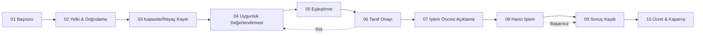

# Operasyon Akışı, Görevler ve Kontrol Noktaları

**TFP | Çeki Demiri — Operasyon Tasarımı v1.0**
Sürüm 1.0 | 20 Ekim 2026 | Çalışma taslağı

> Bu belge, Ana Proje Dosyası §6’nın detaylandırılmış operasyon el kitabıdır. Her adımda kimin ne yaptığı ve **neyi yapmadığı** tanımlanır.

---

## 1. Genel Akış Şeması



---

## 2. Adım Detayları

### 01 — Başvuru

| Alan | Detay |
|---|---|
| **Girdi** | İşletme unvanı, vergi no, MERSİS no, adres, faaliyet konusu |
| **Yetkili kişi** | Ad-soyad, TC no (KVKK asgari), görev, telefon, e-posta, yetki belgesi türü |
| **Amaç** | Kapasite sunma / ihtiyaç bildirme / her ikisi |
| **Sorumlu** | İşletme (beyan), TFP Operasyon (kayıt) |
| **Kontrol** | Zorunlu alanlar, e-posta/telefon doğrulama, KVKK aydınlatma onayı |
| **Çıktı** | `isletme_id`, `basvuru_id`, durum: `beklemede` |
| **TFP’nin yapmadığı** | Yetkiyi varsaymaz, beyanı doğrulanmış saymaz |

**Gerekli belgeler (örnek):**
- Ticaret sicil gazetesi / faaliyet belgesi
- İmza sirküleri / vekâletname (tüzel kişi yetkilisi için)
- Yetkili kişinin kimlik doğrulaması (e-imza veya fiziki ibraz)

---

### 02 — Yetki ve Temel Doğrulama

| Alt Adım | Açıklama | Doğrulayan |
|---|---|---|
| Yetki kontrolü | Yetkili kişinin işletme adına hareket etme yetkisi var mı? | TFP Operasyon |
| Sicil kontrolü | İşletme aktif mi? Vergi/MERSİS tutarlı mı? | TFP Operasyon (açık kaynaklar) |
| İletişim doğrulama | Telefon/e-posta erişimi teyit edildi mi? | Sistem (OTP) |
| Kara liste / risk | Açık kaynak itibar kontrolü (dava, konkordato vb.) | TFP Operasyon |

**Sonuçlar:** `dogrulandi` / `eksik_belge` / `reddedildi (gerekçeli)`

> **Kural:** Yetki doğrulanmadan kapasite/ihtiyaç kaydı eşleşmeye alınmaz.

---

### 03 — Kapasite / İhtiyaç Kaydı

#### Kapasite Kaydı — Alanlar

| Alan | Örnek | Zorunlu |
|---|---|---|
| Kapasite türü | Parsiyel taşıma, üretim hattı, depo alanı | Evet |
| Miktar / birim | 15 palet / 500 saat / 1000 m² | Evet |
| Coğrafya | Çıkış-varış, il/ilçe, tesis adresi | Evet |
| Zaman aralığı | 01–15 Kasım, haftalık tekrar | Evet |
| Koşullar | Soğuk zincir, ADR, tonaj, teknik şartname | Koşullu |
| Geçerlilik | Kayıt hangi tarihe kadar geçerli | Evet |
| Fiyat beklentisi | Açık / gizli / aralık | Hayır |
| Ekler | Fotoğraf, ruhsat, kapasite raporu | Koşullu |

#### İhtiyaç Kaydı — Alanlar

| Alan | Örnek | Zorunlu |
|---|---|---|
| İhtiyaç türü | Taşıma ihtiyacı, fason üretim | Evet |
| Miktar / hacim | 10 palet, 2000 adet | Evet |
| Zaman | Tek sefer / düzenli, son tarih | Evet |
| Koşullar | Teslim yeri, teknik şartname, sertifika | Koşullu |
| Bütçe aralığı | Gizli / aralık | Hayır |
| Geçerlilik | İhtiyaç hangi tarihe kadar güncel | Evet |

**Geçerlilik kuralı:** Süresi dolmuş kayıt otomatik `suresi_doldu` durumuna geçer, eşleşmeye dahil edilmez.

---

### 04 — Uygunluk Değerlendirmesi

Sistem, kayıtları aşağıdaki filtrelerden geçirir:

1. **Zorunlu alan tamamlığı**
2. **Geçerlilik süresi**
3. **Coğrafya / zaman uyumu**
4. **Kapasite türü eşleşmesi**
5. **Doğrulama durumu** (doğrulanmamış → düşük öncelik / işaretli)
6. **Çelişki kontrolü** (aynı işletmenin çelişkili kayıtları)

**Çıktı:** `uygun` / `eksik_bilgi` / `uyumsuz` — her biri gerekçeli.

---

### 05 — Eşleştirme

| Unsur | Açıklama |
|---|---|
| **Girdi** | Uygun durumdaki kapasite ve ihtiyaç havuzu |
| **Mantık (v1.0)** | Kural tabanlı: tür + coğrafya + zaman + miktar aralığı + doğrulama skoru |
| **Skorlama** | Basit ağırlıklandırma (örn. coğrafya %30, zaman %30, miktar %20, doğrulama %20) — **yapay zekâ iddiası yok** |
| **Çıktı** | `eslesme_id`, aday taraflar, **gerekçe metni**, paylaşım düzeyi |
| **Kural** | Gerekçesiz eşleşme üretilmez. Her eşleşme “neden eşleştirildi” açıklamasıyla kaydolur. |

**Örnek gerekçe:**
> “Kapasite #124 (İstanbul→Ankara, 15 palet, 05–10 Kasım, doğrulanmış) ile İhtiyaç #89 (İstanbul→Ankara, 12 palet, 07 Kasım, doğrulanmış) — güzergâh, zaman ve miktar uyumu.”

---

### 06 — Taraf Onayı

1. Taraflara **yalnızca gerekli bilgi** gösterilir (ticari sır / hassas veri filtrelenir).
2. Her tarafa eşleşme bildirimi gider; **onay / ret / revizyon talebi** toplanır.
3. Her iki taraf da onaylarsa → bir sonraki aşama.
4. Taraflardan biri reddederse → gerekçe kaydedilir, kayıt havuza döner.

**İzin matrisi:**

| Bilgi | Onay Öncesi | Onay Sonrası |
|---|---|---|
| İşletme unvanı | Maskelenmiş / sektör + il | Açık |
| İletişim | Gizli | Onay sonrası paylaşılır |
| Kapasite/ihtiyaç detayı | Özet | Tam detay |
| Fiyat | Gizli (taraflar belirler) | Taraflar arası |

---

### 07 — İşlem Öncesi Açıklama (Zorunlu Bilgilendirme)

Taraflara **yazılı olarak** bildirilir:

- [ ] TFP tarafların yerine işlem yapmaz; taraflar kendi adlarına hareket eder.
- [ ] Banka, noter, tapu, gümrük vb. onaylar ilgili kurumların prosedürüne tabidir.
- [ ] Eşleşme, finansman / kâr / işlem garantisi değildir.
- [ ] Hizmet bedelinin **hangi koşulda doğacağı**, oranı/hesabı, fatura ve iptal kuralları.
- [ ] Kişisel/ticari verilerin işlenme amacı ve paylaşım düzeyi (KVKK).

Onay alınmadan harici işleme geçilmez.

---

### 08 — Harici İşlem (TFP’nin Taraf Olmadığı Aşama)

**Bu aşamanın kuralı nettir: İşlem bankada olur, resmi olur.**

- Sözleşme, ödeme, banka kredisi, noter, tapu, gümrük, taşıma sözleşmesi vb. **tarafların ve ilgili kurumların** kendi prosedürlerine göre yürütülür.
- Para/nakit akışı **limit sahibinin kendi banka hesabında** yürütülür. TFP’nin havuzuna, TFP’nin hesabına veya emanetine hiçbir tutar girmez.
- TFP bu aşamada **karar mercii değil, kontrol mercii'dir**: **TFP'den iki kişi** işlemin başında/işlem yerinde bulunur; limitin gerçekliğini, malın/deponun/tırın varlığını, belgelerin tutarlılığını **yerinde görerek** teyit eder. Onay mercii banka, karar mercii taraflardır.
- TFP bu aşamada **gözlemci, yerinde kontrol eden ve kayıt tutucudur**, taraf değildir.
- Taraflar isterlerse TFP’ye durum güncellemesi sağlar; TFP bu bilgiyi kaydeder.

**Gün Sonu Kuralı (17:30):** İşlem mesai bitimine yetişmezse durulur; taraflar kendi evrakıyla bankadan ayrılır (çeki olan çekiyle, limiti olan limitiyle). TFP personeli hiçbir evrakı refakat etmez veya emanet almaz. Ertesi sabah aynı masada yeniden buluşulur. Gece için kimsede emanet yoktur.

> **Sınır:** TFP bu aşamada para/belge teslim almaz, vekâleten imza atmaz, kefil olmaz, borç vermez, banka onayı garantilemez.
>
> **Ama not:** Hukuki sorumluluk yoktur; **insani sorumluluk vardır.** Çeki demiri koparsa tır savrulur — yerinde kontrol bu yüzden formalite değil, yükümlülüktür.

---

### 09 — Sonuç Kaydı

| Sonuç | Tanım | Örnek |
|---|---|---|
| `tamamlandi` | İşlem taraflarca sonuçlandırıldı | Taşıma yapıldı, üretim teslim edildi |
| `kismen_tamamlandi` | Kısmi ifa | 10 paletten 7’si taşındı |
| `sonuclanmadi` | Anlaşma olmadı / işlem gerçekleşmedi | Fiyat anlaşmazlığı, vazgeçme |
| `iptal_edildi` | Taraflardan biri çekildi | Gerekçe kayıtlı |

Her sonuç için **dayanak** (tarafların beyanı, belge, tarih) zorunludur.

---

### 10 — Ücretlendirme ve Kapanış

1. Ücret tetikleyicisi gerçekleşti mi kontrol edilir (Bkz. Ana Dosya §9).
2. Fatura düzenlenir (e-fatura), tahsilat takibi yapılır.
3. Kayıtlar **denetim iziyle** saklanır (kim, ne zaman, neyi değiştirdi).
4. Taraflara kapanış bildirimi ve memnuniyet geri bildirimi (opsiyonel).

---

## 3. Durum Makinesi

```
                    ┌─────────────┐
                    │   taslak    │
                    └──────┬──────┘
                           ▼
              ┌────────────────────┐
              │ dogrulama_bekliyor │
              └─────────┬──────────┘
                        ▼
              ┌──────────────────┐
              │  eslesme_ariyor  │◄──────────┐
              └────────┬─────────┘           │
                       ▼                     │
                 ┌──────────┐           ┌────┴─────┐
                 │ eslesti  │           │ ret/iptal │
                 └────┬─────┘           └──────────┘
                      ▼
        ┌─────────────────────────┐
        │ taraf_onayi_bekliyor    │
        └────────────┬────────────┘
                     ▼
              ┌──────────────┐
              │ gorusuluyor  │
              └──────┬───────┘
                     ▼
              ┌──────────────┐
              │ dogrulaniyor │
              └──────┬───────┘
                     ▼
         ┌───────────────────┐
         │ anlasma_saglandi  │
         └────────┬──────────┘
                  ▼
    ┌─────────────────────────┐
    │ tamamlandi / kismen /   │
    │ sonuclanmadi / iptal    │
    └─────────────────────────┘
```

Her geçişte: `eski_durum`, `yeni_durum`, `degistiren_kisi`, `tarih`, `gerekce`.

---

## 4. Rol ve Yetki Matrisi

| Rol | Yetkileri | Erişim |
|---|---|---|
| **Sistem Yöneticisi** | Kullanıcı yönetimi, rol atama, log görüntüleme | Tüm modüller (yazma) |
| **Operasyon Sorumlusu** | Başvuru doğrulama, eşleştirme onayı, durum güncelleme | İşletme, kapasite, ihtiyaç, eşleşme, işlem takibi |
| **İzleyici / Denetçi** | Salt okunur, raporlama | Tüm kayıtlar (okuma) |
| **İşletme Yetkilisi** | Kendi işletmesinin kayıtlarını yönetme | Kendi işletmesi |
| **Misafir** | Başvuru oluşturma | Başvuru formu |

---

## 5. Kontrol Noktaları Özeti

- [ ] Yetki doğrulanmadan eşleşme yok
- [ ] Süresi dolmuş kayıt eşleşmeye alınmaz
- [ ] Doğrulanmamış bilgi doğrulanmış gibi görünmez
- [ ] Onay yoksa iletişim bilgisi paylaşılmaz
- [ ] İşlem öncesi bilgilendirme yazılı ve kayıtlı
- [ ] Ücret tetikleyicisi sözleşmede tanımlı, eşleşme ≠ ücret
- [ ] Her durum değişikliği denetim izine yazılır

